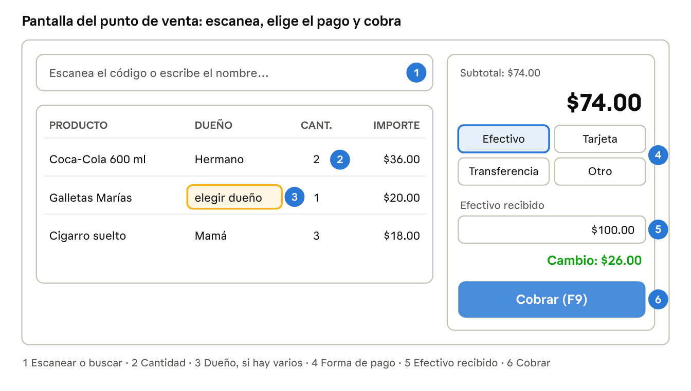
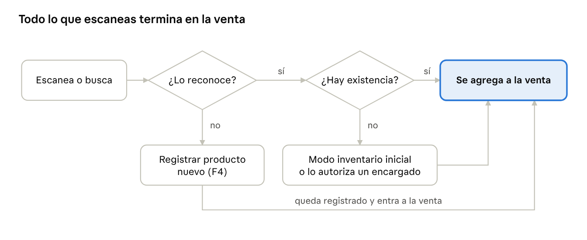
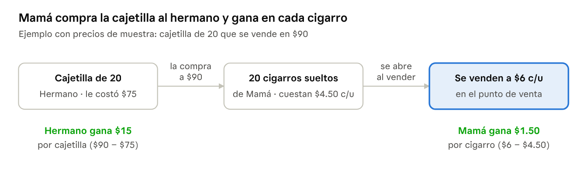

# Guía de uso de StorePOS

Guía para quienes atienden la tienda: vender, registrar productos, ajustar el inventario y recibir a los proveedores.

> Las imágenes son dibujos de las pantallas; la pantalla real puede verse un poco distinta.

**Contenido**

1. [Antes de empezar](#antes-de-empezar)
2. [Cómo vender normalmente](#cómo-vender-normalmente)
3. [Cómo vender un producto que no está registrado](#cómo-vender-un-producto-que-no-está-registrado)
4. [Cómo vender un producto sin existencia](#cómo-vender-un-producto-sin-existencia)
5. [Cómo registrar un producto](#cómo-registrar-un-producto)
6. [Cómo modificar el inventario](#cómo-modificar-el-inventario)
7. [Proveedores y entregas](#proveedores-y-entregas)
8. [Al terminar el día y problemas comunes](#al-terminar-el-día-y-problemas-comunes)

## Antes de empezar

Para vender necesitas tres cosas: StorePOS abierto, tu sesión iniciada y la caja abierta.

1. Haz doble clic en el acceso directo **StorePOS** del escritorio. Se abre una **ventana negra** y después el navegador.
2. Escribe tu **usuario** y **contraseña** y presiona **Entrar**.
3. Ve a **Caja y corte**, escribe cuánto efectivo hay en la caja para dar cambio (el **fondo inicial**) y presiona **Abrir caja**.

**La ventana negra es el sistema.** No la cierres mientras se vende; si la cierras, StorePOS deja de funcionar en todos los dispositivos.

Si el sistema deja de responder y el título de la ventana negra empieza con **“Seleccionar”**, haz clic en ella y presiona la tecla **Esc**. El sistema sigue solo.

| Rol | Qué puede hacer |
| --- | --- |
| Cajero | Vender, abrir y cerrar caja, registrar gastos y solicitudes de clientes |
| Encargado | Lo anterior + descuentos, cancelar ventas, productos, inventario, dueños, proveedores, surtido y reportes |
| Administrador | Todo, incluidos usuarios, configuración y respaldos |

## Cómo vender normalmente

En **Punto de venta** se escanea cada producto, se elige cómo paga el cliente y se presiona **Cobrar**.

1. **Agrega los productos.** Escanea el código de barras con el lector. Si no tiene código, escribe parte del nombre en la barra de búsqueda, elige con las flechas ↑ ↓ y presiona **Enter**.
2. **Revisa las cantidades.** Escanear el mismo producto otra vez suma 1. Para cambiar la cantidad, escribe el número en la columna **Cantidad**. En productos por kilo escribe los kilos con decimales (por ejemplo **0.250** para 250 g).
3. **Dueño.** Si un producto tiene mercancía de varios dueños, la casilla de **Dueño** se marca en amarillo: elige de quién es lo que se vende. Si solo hay un dueño, se elige solo.
4. **Forma de pago.** Toca **Efectivo**, **Tarjeta**, **Transferencia** u **Otro**.
5. **Efectivo recibido.** Si paga en efectivo, escribe cuánto te dio. El **Cambio** aparece abajo.
6. Presiona **Cobrar** (o la tecla **F9**). La venta queda guardada y aparece **Imprimir ticket**.

| Tecla | Qué hace |
| --- | --- |
| F2 | Volver a la barra de búsqueda |
| F4 | Registrar un producto nuevo |
| F9 | Cobrar |
| Esc dos veces | Vaciar la venta |

**Para quitar un producto** presiona la ✕ de su renglón. **Descuentos** y **cancelar una venta ya cobrada** solo los puede hacer un encargado: la cancelación se hace en **Historial de ventas → Ver → Cancelar venta**, y la mercancía regresa al inventario.

Si aparece **“El servidor no responde”**, revisa la ventana negra (la tecla **Esc**). Antes de volver a cobrar, mira en **Historial de ventas** si la venta ya quedó registrada.

## Cómo vender un producto que no está registrado

Si escaneas un código que el sistema no conoce, puedes darlo de alta ahí mismo y venderlo sin salir del punto de venta.

1. Escanea el producto. Aparece **“Código nuevo: regístralo para venderlo”** y se abre el cuadro **Registrar producto nuevo** con el código ya escrito. También puedes abrirlo con **F4** o con el botón **+ Producto nuevo**.
2. Llena lo mínimo:
    - **Nombre** (por ejemplo “Sabritas sal 45 g”).
    - **Precio de venta**.
    - **Precio de compra**: lo que te costó. Si no lo sabes, déjalo vacío y corrígelo después en **Productos**.
    - **¿De quién es?**: el dueño de esa mercancía.
    - **¿Cuántos hay en el estante?**: cuéntalos *incluyendo* los que vas a vender. Es opcional, pero así el inventario queda correcto desde el principio.
3. Presiona **Registrar y agregar a la venta**. El producto entra a la venta y sigues cobrando como siempre.

La próxima vez que lo escanees, ya lo reconoce.

**¿Quién puede hacerlo?** Un encargado o administrador siempre. Un cajero solo cuando está activo el **modo inventario inicial** (siguiente sección). Si a un cajero le aparece “Pide a un encargado que lo dé de alta”, ese modo está apagado.

Si el cliente pidió algo que **no tienes en la tienda**, no lo des de alta: anótalo en **Solicitudes de clientes** para saber qué conviene comprar.

## Cómo vender un producto sin existencia

Pasa cuando la mercancía está en el estante pero el sistema dice 0: nunca la registraste, o tenías más de lo que creías. Hay dos formas de venderla sin que el inventario quede en negativo.

**Mientras capturas tu inventario: modo inventario inicial** (lo activa un administrador)

1. Ve a **Configuración** → *Empezar con la mercancía que ya tienes*.
2. Marca **Modo inventario inicial** y elige el **Dueño por defecto** de la mercancía que ya tenías.
3. Presiona **Guardar configuración**. Verás un aviso amarillo en el Tablero y en el Punto de venta.

Con el modo activo, vende normal: si un producto no tiene existencia, las piezas vendidas se registran solas como **inventario inicial** del dueño, a su precio de compra. Cuando termines de capturar tu mercancía, **desactívalo**, para que el sistema vuelva a avisarte cuando algo se agote.

**Un caso suelto: autorización del encargado**

Sin el modo activo, el sistema detiene la venta con “Inventario insuficiente”. Un encargado puede marcar **Autorizar venta sin existencia** (abajo del botón Cobrar) y cobrar. Queda registrado en la bitácora.

**Después: corrige el número real.** Cuenta lo que hay y regístralo con **Conteo físico** (ver [Cómo modificar el inventario](#cómo-modificar-el-inventario)). Así la existencia vuelve a ser la verdadera.

## Cómo registrar un producto

Los productos se registran en **Productos → + Nuevo producto** (encargado o administrador).

| Campo | Qué escribir |
| --- | --- |
| Nombre | Como lo buscarías: marca, sabor y tamaño (“Coca-Cola 600 ml”) |
| Código de barras | Haz clic en la casilla y escanea el producto |
| Categoría | Refrescos, botanas, lácteos… (se crean en **Categorías**) |
| Se vende por | **Pieza**, o **Kilogramo** para productos a granel |
| Precio de compra | Lo que te cuesta cada pieza o kilo |
| Precio de venta | Lo que cobras |
| Existencia mínima | Con cuántas piezas quieres que te avise que se está acabando |
| Proveedor habitual | Quién te lo surte (sirve para las listas de surtido) |
| Dueño prioritario | Solo si usas el modo de reparto automático entre dueños |

**Existencia inicial (opcional):** al crearlo puedes escribir cuántos hay en el estante y de qué dueño son. Si hay piezas de varios dueños, déjalo vacío y agrégalas en **Inventario**.

Presiona **Guardar**, o **Guardar y registrar otro** para capturar varios seguidos.

**Cambiar un precio:** **Productos → Editar**. Las ventas pasadas conservan el precio con el que se vendieron. Un producto que ya no vendes se **desactiva** (quita la casilla *Activo*); solo se puede eliminar si nunca tuvo ventas ni inventario.

**Cigarros por caja y sueltos:** registra los dos productos (la cajetilla y el cigarro suelto), por pieza. Luego abre el suelto en **Inventario** y, en **Caja y sueltos**, elige su caja, cuántas piezas trae y de quién son los sueltos. Cuando se acaben los sueltos, el punto de venta abre una caja solo; si la caja es de otro dueño, quien vende los sueltos se la compra al precio de venta de la caja.

Si la cajetilla y los sueltos son del mismo dueño, no hay compra: cada cigarro cuesta lo que costó la caja entre 20 ($75 ÷ 20 = $3.75), y la ganancia es mayor.

## Cómo modificar el inventario

El inventario nunca se “escribe encima”: cada cambio queda como un movimiento con fecha, usuario y motivo. Todo se hace desde **Inventario** → clic en el nombre del producto (encargado o administrador).

| Necesitas… | Usa | Ejemplo |
| --- | --- | --- |
| Sumar mercancía que compraste o encontraste | **Agregar existencia** (tipo Resurtido, Inventario inicial, Devolución de cliente o Corrección) | Compraste 12 refrescos en la central |
| Sacar mercancía que se tiró | **Merma o salida** → Dañado / caducado | 3 yogures caducados |
| Dejar el número igual a lo que contaste | **Conteo físico** | El sistema dice 10 y en el estante hay 8 |
| Pasar mercancía de un dueño a otro | **Traspaso entre dueños** (con el precio acordado) | Tu mamá le compra 6 piezas a tu hermano |
| Abrir cajetillas para vender sueltos | **Caja y sueltos** → Abrir ahora | Abrir 1 cajetilla de 20 |

En cada caso elige el **dueño**, la **cantidad** y escribe el **motivo** cuando lo pida.

**El conteo físico es la herramienta más útil:** no tienes que calcular la diferencia, solo escribe lo que contaste y el sistema registra la entrada o salida que falte.

**Para revisar:** en la misma página ves la existencia por dueño, los lotes con su costo y el historial completo. **Inventario → Historial de movimientos** muestra los de todos los productos, con filtros por fecha, tipo y dueño. En la lista de Inventario, el filtro **Estado** muestra agotados, existencia baja o cerca del mínimo.

## Proveedores y entregas

Registrar a tus proveedores te dice quién viene cada día y hace que la mercancía que entregan entre al inventario con su costo real.

**1. Dar de alta un proveedor** — **Proveedores y entregas → + Nuevo proveedor**: nombre (Bimbo, Coca-Cola…), contacto, teléfono y los **días en que visita**. Esos días aparecen en el Tablero como *Próximas entregas*. Después, en cada producto, elige ese proveedor como **Proveedor habitual**.

**2. Registrar una entrega** — cuando llega el repartidor:

1. **Proveedores y entregas → Registrar entrega**.
2. Elige el **proveedor**, escribe el número de **factura o nota** y el **dueño por defecto** (quien pagó la mercancía).
3. Escanea cada producto que llegó, o escribe su nombre. Escribe la **cantidad** y el **costo unitario** de la nota; cambia el dueño en el renglón si alguna parte es de otra persona.
4. Presiona **Guardar entrega y agregar a inventario**. La existencia sube en ese momento.

Deja marcada la casilla de actualizar el precio de compra si el costo cambió; así las siguientes ganancias se calculan con el costo nuevo.

**3. Cambios y devoluciones al proveedor**

| Qué pasó | Qué registrar |
| --- | --- |
| El proveedor se llevó producto dañado o caducado y **te dejó la misma cantidad del mismo producto** | **Nada.** Tu existencia no cambió: déjalo en blanco |
| Se lo llevó y **no te dejó nada** | **Merma o salida** en ese producto, motivo “devuelto a proveedor” |
| Se lo llevó y **te dejó otro producto** | **Merma o salida** del que se llevó + **Registrar entrega** del que dejó |
| Te dejó de más o de menos de lo que dice la nota | Registra en la entrega lo que **realmente llegó** |

**4. Listas de surtido** (para saber qué pedir) — **Listas de surtido → Generar lista** propone cuánto comprar según lo que vendes y cuándo viene el proveedor. Ajusta las cantidades, imprímela (también en ticket) y, cuando llegue la mercancía, usa **Recibir mercancía** para que entre al inventario. Crear la lista no cambia el inventario.

## Al terminar el día y problemas comunes

**Corte de caja:** ve a **Caja y corte → Hacer corte y cerrar el día**, cuenta el efectivo de la caja y escríbelo en **Efectivo contado**. Si no cuadra con lo esperado, escribe la explicación. Presiona **Imprimir en ticket** para guardar el comprobante. Durante el día, los gastos, retiros y depósitos se registran en **Caja y corte → Registrar movimiento de efectivo**; las ventas con tarjeta nunca cuentan como efectivo.

| Problema | Solución |
| --- | --- |
| Todo se quedó congelado | Revisa la ventana negra: si su título empieza con “Seleccionar”, haz clic en ella y presiona **Esc** |
| “La caja está cerrada” al cobrar | Abre la caja en **Caja y corte** |
| “Tiene inventario de varios dueños” | Elige el dueño en la casilla amarilla del renglón |
| “Inventario insuficiente” | Un encargado autoriza la venta, o se activa el modo inventario inicial |
| “Sin permiso” | Tu usuario no tiene ese rol; pídelo a un administrador |
| Me equivoqué en una venta ya cobrada | Un encargado la cancela en **Historial de ventas → Ver** |
| El celular no abre el sistema | Debe estar en el mismo Wi-Fi que la computadora de la tienda |
